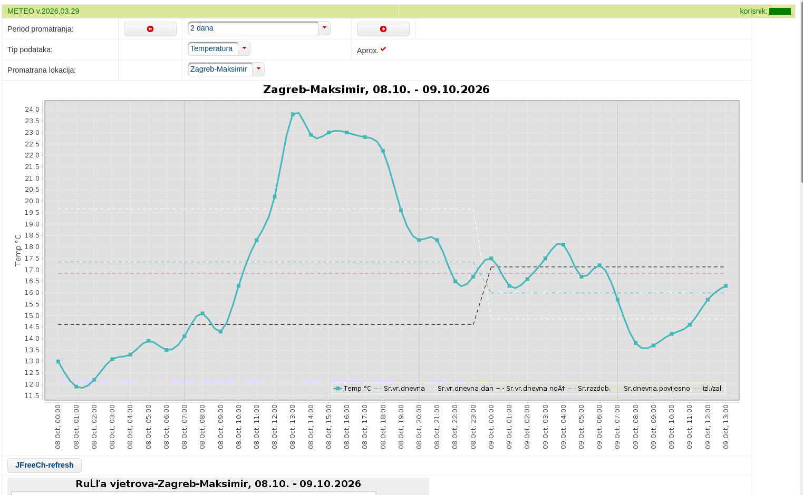
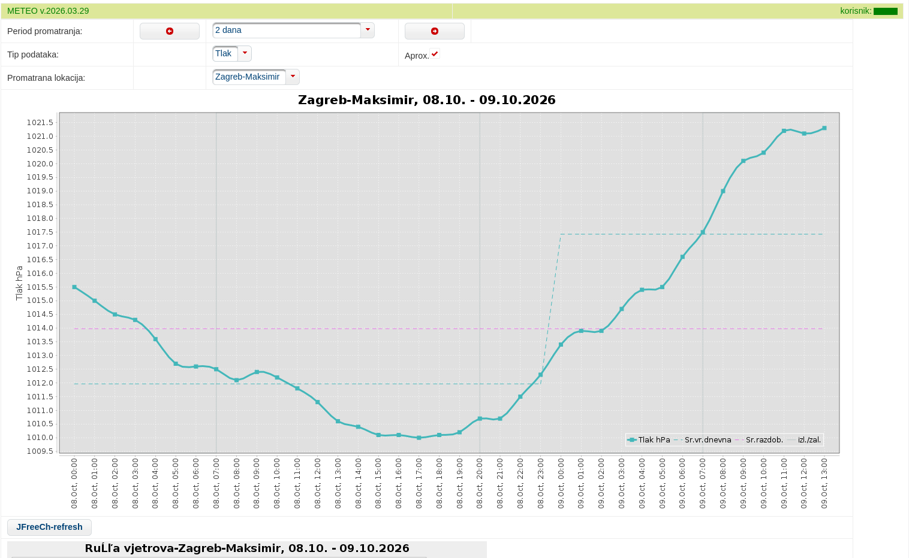
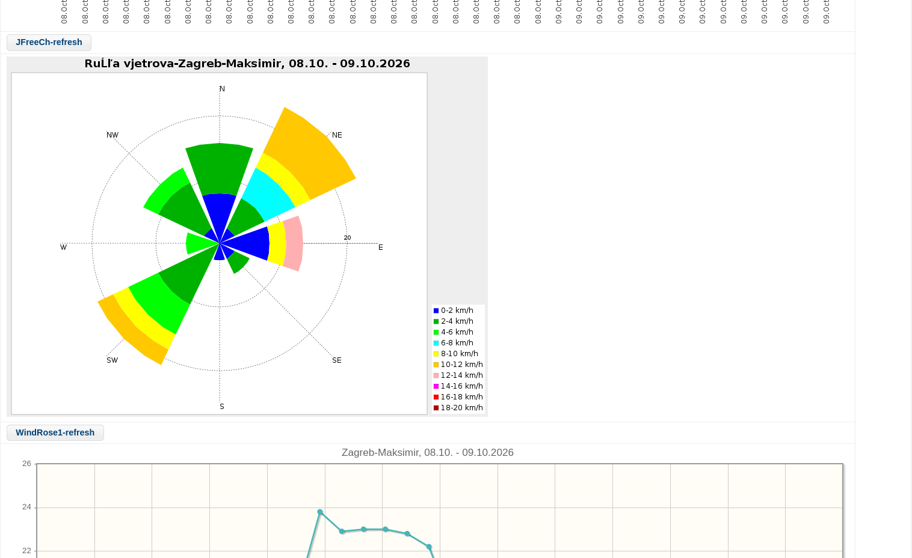
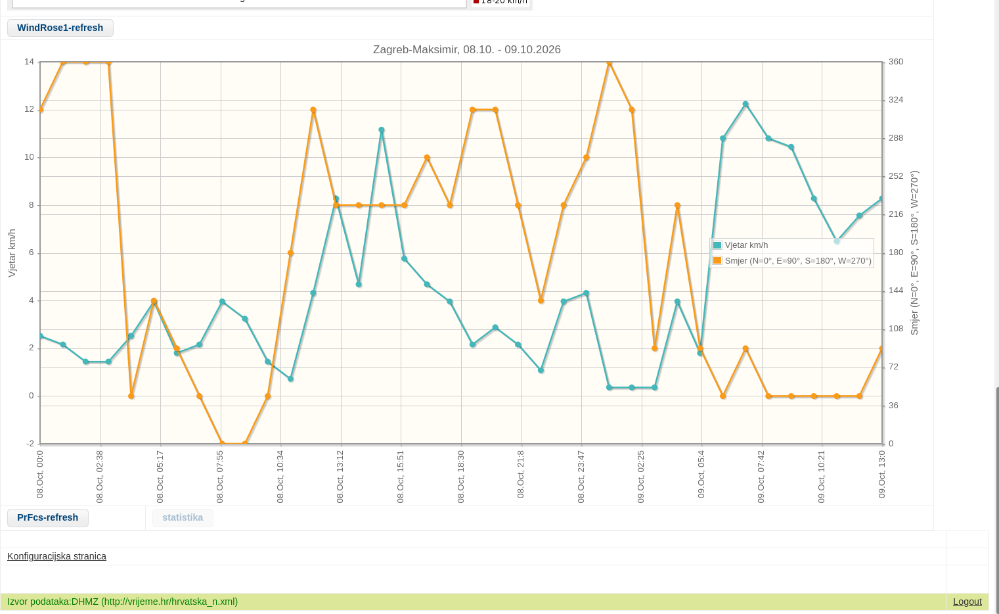

## Meteo_2016

### Opis projekta
Hobistički rest-klijent web app projekt koji svakog sata čupa podatke sa DHMZ servisa [https://vrijeme.hr/hrvatska_n.xml](https://vrijeme.hr/hrvatska_n.xml), za par odabranih gradova, te ih pohranjuje u lokalnu mysql bazu podataka, sa frontend web sučeljem koje prikazuje podatke o temperaturi, tlaku, vlazi i vjetru za odabrani vremenski period u obliku klasičnog 2D grafičkog prikaza ili ruže vjetrova.  
Raw XML odziv DHMZ-ovog rest servisa može se vidjeti sa: *curl -s "https://vrijeme.hr/hrvatska_n.xml"*  

## Korištene tehnologije
- JSF 2.2 sa PrimeFaces 5.3 kao frontend
- Java 8 kao backend
- Maven kao project build engine
- Eclipse kao preporučeni IDE
- Mysql 5.5. ili 5.7 kao baza podataka
- Tomcat 7-9 server kao deploy target

## Deploy

### Preporučene predinstalacije:
1. Linux OS host
2. Mysql  5.5-5.7  
3. Apache Tomcat  7>
4. Java 8>  
5. Ecplipse IDE  

### Build & deploy:

1. *git clone [https://github.com/zvone-cu/meteo_2016.git](https://github.com/zvone-cu/meteo_2016.git)*
2. importati klonirani projekt kao maven project u eclipse
3. kreirati bazu podataka METEO_DHMZ sa ovlaštenim userom 

	>*sudo mysql -u root -p  
	CREATE DATABASE METEO_DHMZ CHARACTER SET utf8mb4 COLLATE utf8mb4_unicode_ci;  
	CREATE USER 'nazivusera'@'localhost' IDENTIFIED BY '123';  
	GRANT ALL PRIVILEGES ON METEO_DHMZ.* TO 'nazivusera'@'localhost';    
	FLUSH PRIVILEGES;  
	exit;  

4. kreirati radne tablice pomoću primjera u **./resources/ddlovi.sql**, 
	>prethodno u navedenom fajlu prilagoditi:  
	- dozvoljene username i passworde za korisnike web aplikacije u tablici **KORISNICI** po osobnim željama
	- odabrati gradove po želji dostupne na HDMZ-servisu i ubaciti u **SELEKTIRANI_GRADOVI**; Po defaultu su dodani Zagreb-Maksimir, Senj i Zavižan  
	popis svih dostupnih gradova možete dobiti sa  
	>*curl -s "https://vrijeme.hr/hrvatska_n.xml" | xmllint --xpath "//GradIme/text()" - | sort -u*  
	- za svaki dodatni nedefaultni grad popuniti tablicu temperaturnih prosjeka i padalina za 12 mjeseca u godini u tablici **PROSJECI**; 

	>*mysql -u nazivusera -p METEO_DHMZ < ./resources/ddlovi.sql*  
	
5. updejatati konekcijske parametre baze (nazivusera/pwd) u sve **persistence.xml** fajlove u projektu
6. generirati **meteo_2016.war** deploy artefakt izvršavanjem maven targeta **clean install**, uz opciju *skip tests*
7. deployati kreirani meteo_2016.war artefakt s projektnog **target** foldera na tomcat server webapp folder. 
   ako se želi da maven obavlja automatski deploy an tomcat, updejtati glavni **pom.xml** parametrima ovlaštenog tomcat usera u bloku za *plugine* (*tomcat7-maven-plugin*)
8. webappu se pristupa browserom na **\<tomcat adresa\>/meteo_2016**

 
## License

This project is licensed under the GNU General Public License v3.0 - see the LICENSE file for details.  

